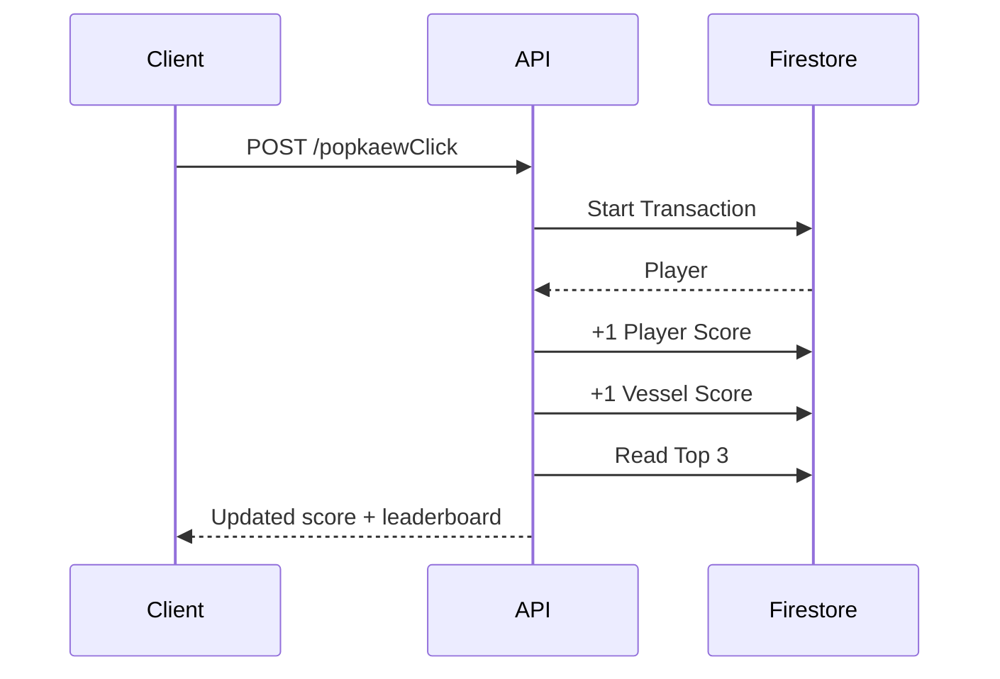

# Popkaew API Documentation

> Version: 1.0

## Overview

Popkaew is a click-based event game backend built with **Next.js**, **Firebase Firestore**, and the **Firebase Admin SDK**. This document is intended for frontend developers integrating with the API.

## Architecture

```text
Frontend
   │
   ▼
Next.js API Routes
   │
   ▼
Service Layer
   │
   ▼
Firestore
```

## Authentication

All endpoints require an authenticated participant session.

---

# Base URL

Development

```text
http://localhost:3000/api
```

Production

```text
https://<your-domain>/api
```

---

# Firestore Collections

## popkaewPlayer

| Field        | Type      | Description           |
| ------------ | --------- | --------------------- |
| id           | string    | Document ID           |
| name         | string    | Player name           |
| vessel       | string    | Vessel ID             |
| group        | string    | Group ID              |
| popkaewscore | number    | Current score         |
| lastClickAt  | Timestamp | Last successful click |

## popkaewVessel

| Field        | Type   |
| ------------ | ------ |
| id           | string |
| vesselName   | object |
| popkaewscore | number |

---

# API Reference

## POST /popkaewClick

Increment the authenticated player's score by **1**.

### Request

No body required.

### Success Response

```json
{
  "success": true,
  "data": {
    "score": 245,
    "leaderboard": [
      {
        "rank": 1,
        "vesselName": {
          "en": "Garuda",
          "th": "ครุฑ"
        },
        "popkaewscore": 10452
      }
    ]
  }
}
```

### Backend Process



---

## GET /popkaewLeaderboard

Returns vessels sorted by score descending.

### Response

```json
{
  "success": true,
  "data": [
    {
      "rank": 1,
      "id": "garuda",
      "popkaewscore": 10452
    }
  ]
}
```

---

## GET /popkaewPlayer/:id

Returns player information.

### Response

```json
{
  "success": true,
  "data": {
    "id": "abc123",
    "name": "John",
    "group": "A",
    "vessel": "garuda",
    "popkaewscore": 245
  }
}
```

---

# Common Status Codes

| Code | Meaning               |
| ---: | --------------------- |
|  200 | Success               |
|  401 | Unauthorized          |
|  404 | Player not found      |
|  500 | Internal server error |

---

# Frontend Integration

## Initial Page Load

1. Fetch current player.
2. Display score.
3. Fetch leaderboard.

## On Click

```ts
const res = await fetch("/api/popkaewClick", {
  method: "POST",
  credentials: "include",
})

const result = await res.json()

setScore(result.data.score)
setLeaderboard(result.data.leaderboard)
```

No additional leaderboard request is necessary because the click endpoint returns the updated leaderboard.

---

# TypeScript Models

```ts
export interface Player {
  id: string
  name: string
  vessel: string
  group: string
  popkaewscore: number
}

export interface LeaderboardItem {
  rank: number
  id: string
  vesselName: {
    en: string
    th: string
  }
  popkaewscore: number
}
```

---

# Notes

- Score updates use Firestore transactions.
- Player and vessel scores are updated atomically.
- Server timestamps are used for `lastClickAt`.
- Frontend should treat all responses as the source of truth.

---

# Future Endpoints

- POST /popkaewPlayer
- PATCH /popkaewPlayer/:id
- GET /popkaewVessel/:id
- GET /popkaewLeaderboard/top3
- GET /popkaewLeaderboard/live
